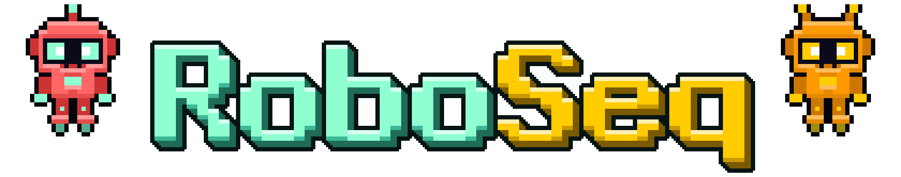
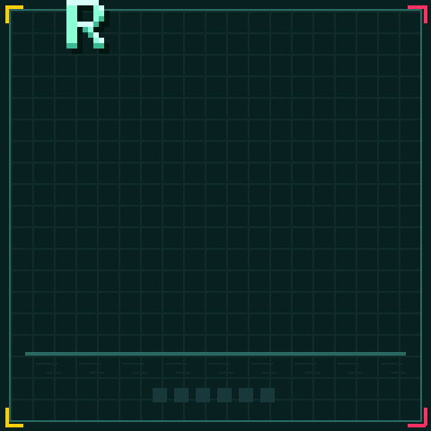
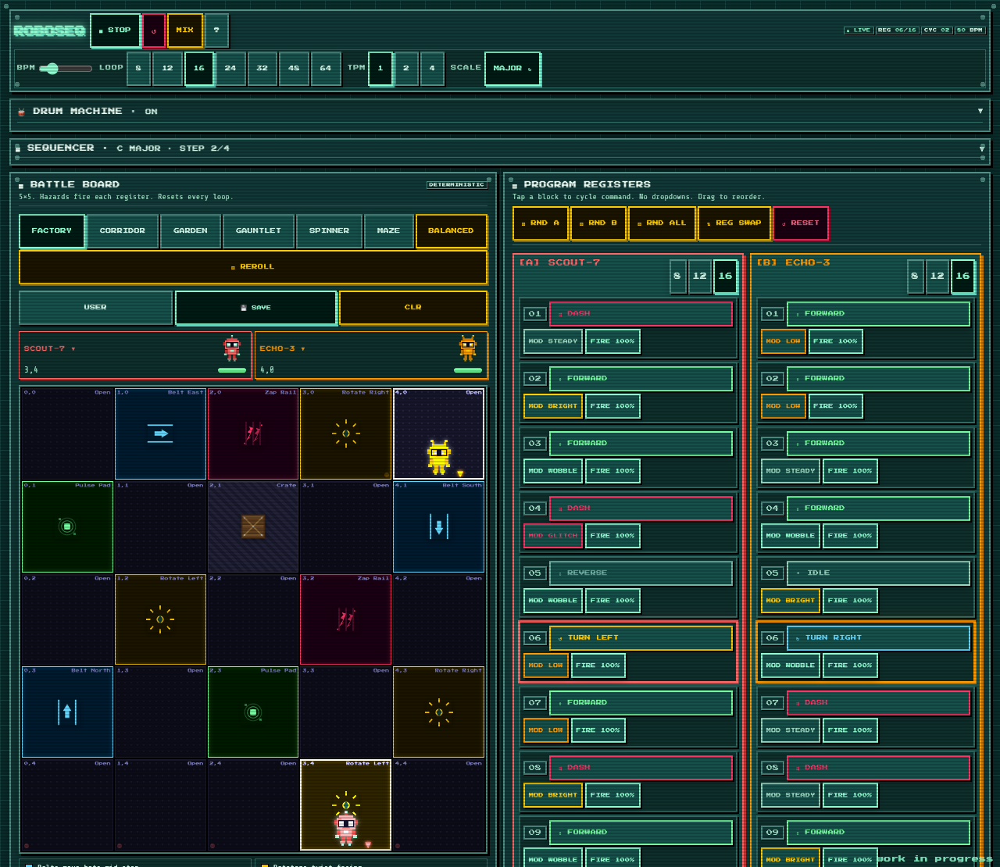
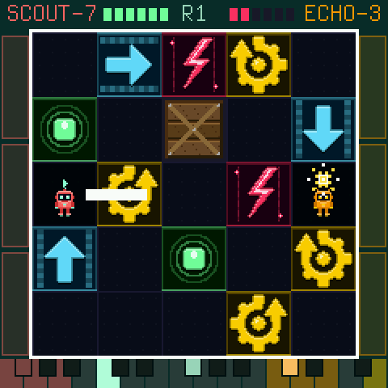
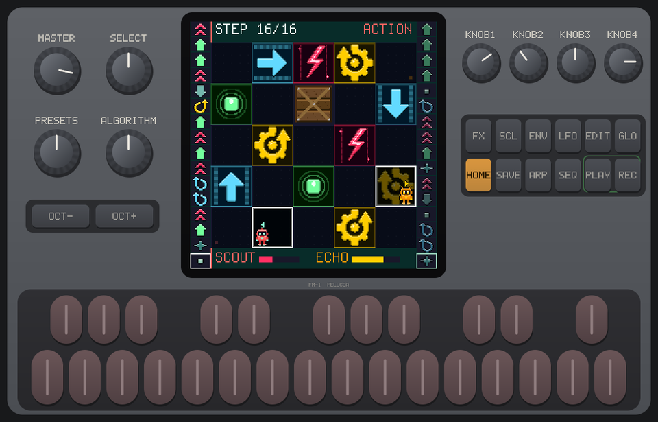
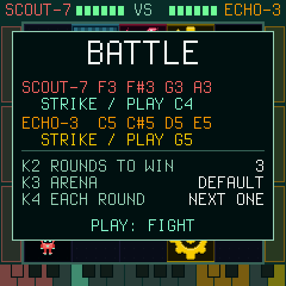
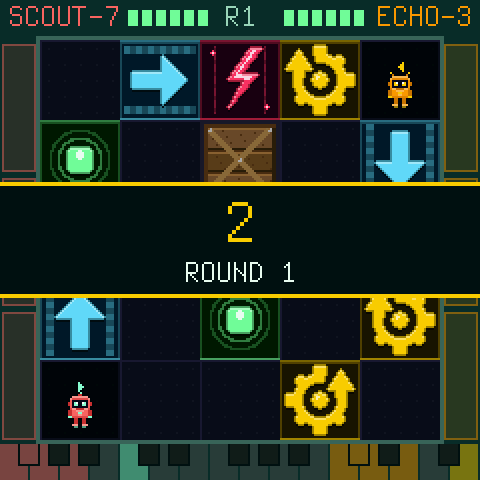
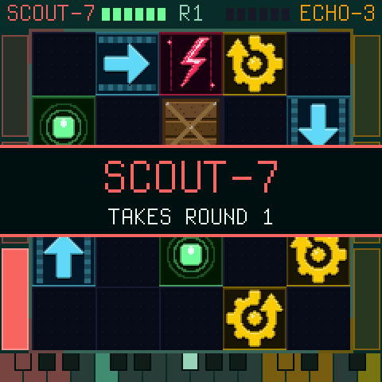
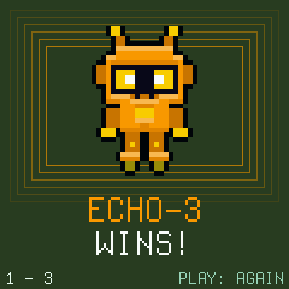

<p align="center"></p>

# RoboSeq for the M-VAVE FM-1

A sequencer that is a board game. Two robots walk a 5 x 5 board of conveyor belts, zap rails and rotators, each
running a program of moves, and where they go, what they ride and what they bump into is the music. You play it by
reaching in while it runs: steer them on the black keys, rewrite their programs, change their board, solo over them,
or hand a friend the other end of the keyboard and fight them on the beat. A Dinghy 0.4 app, in the same family as
[VaveHero](https://github.com/joakimskurk/fm1vavehero), [Star Distroyer](https://github.com/joakimskurk/fm1stardistroyer)
and [SkurkyMello](https://github.com/joakimskurk/fm1mello).

> **Status: playable, not yet on a real FM-1.** Every page, both engines, the lead and the battle are in, and the
> project is kept over a power-off. It is tested on the computer and measured in
> [fm1-emu](https://github.com/joakimeriksson/fm1-emu), but it has not met a real FM-1: if you have one,
> [FIRST_FLASH.md](FIRST_FLASH.md) is a half-hour checklist with the way back (hold OCT- while switching on). The plan
> is in [ROADMAP.md](ROADMAP.md).

<p align="center"></p>

<p align="center"></p>

This one started as a little browser toy with a simple question: what if a sequencer were a board game? Two robots,
register cards borrowed in spirit from RoboRally, a board full of conveyor belts and zap rails, and every move they
make turned into a note. It was meant to be a quick experiment.

Bringing it to the FM-1 was a chance to make it something you play with your hands instead of clicking at: steer the
robots, build their board, type their programs in as if you were driving them, and solo over the chaos they make.
It is more toy than tool, and that is the point. And now two of you can fight with them, on the beat.

It has not met a real FM-1 yet, so please be kind.

Enjoy the robots.

*- Joakim*

[](https://buymeacoffee.com/skurk)

## Contents

**Getting started**
1. [What it is](#what-it-is)
2. [Try it](#try-it)
3. [Install](#install)
4. [Your first five minutes](#your-first-five-minutes)
5. [The panel and the keyboard](#the-panel-and-the-keyboard)

**Lessons**
- [1. Play and steer](#lesson-1-play-and-steer)
- [2. Program the robots](#lesson-2-program-the-robots)
- [3. Build their world](#lesson-3-build-their-world)
- [4. Chords and progressions](#lesson-4-chords-and-progressions)
- [5. Drums and the mix](#lesson-5-drums-and-the-mix)
- [6. Play solo](#lesson-6-play-solo)
- [7. Battle: two players](#lesson-7-battle-two-players)

**Reference**
- [The two engines](#the-two-engines)
- [Every page](#every-page)
- [The rules of the game](#the-rules-of-the-game)
- [Build it yourself](#build-it-yourself)
- [Where things are](#where-things-are)

---

## What it is

Two little robots, **Scout-7** (red) and **Echo-3** (orange), walk a 5 x 5 board of conveyor belts, zap rails,
rotators, pulse pads and crates. Each runs its own program of moves: forward, back, turn, dash, ping, idle. Where they
go, what they ride, what they bump into and when they meet becomes the music.

- **You play it** by reaching into the robots while they run. Steer them, rewrite their programs, swap their board,
  change the chords. Everything you change is heard on their next step.
- **It has two engines.** **BAND**, where it starts, turns the robots into a band: a tune that comes back every bar,
  an answering voice, a bass groove per board, a drummer, songs with a big chorus. **ORIGINAL** is the browser
  original's score, note for note.
- **It has a battle mode.** Two players, a robot each, moving on the beat, until one burns out.

<p align="center">
  
  
  
  
  
</p>

RoboSeq began as a browser instrument ([reference/roboseq.html](reference/roboseq.html)), which stays the reference
for how it sounds and behaves. This is its port to the FM-1 as firmware, built on
[Dinghy](https://github.com/zvenson/dinghy) 0.4 by zvenson and, under that, the Felucca / SLOOP platform, made the same
way as [SkurkyMello](https://github.com/joakimskurk/fm1mello).

## Try it

**The original, in a browser.** Open [`reference/roboseq.html`](reference/roboseq.html) in a browser (it loads
Tone.js from the internet). The space bar or `S` plays and stops, `R` rolls new programs for both robots and `U`
undoes; everything else is clicked: the presets, the board's tiles, every step. This is RoboSeq as it began, and it
stays the reference for how the firmware sounds and behaves.

**The firmware, without an FM-1.** fm1-emu runs the FM-1's own packages in the browser:
1. Download `roboseq-X.Y.fwsc` from the [releases](https://github.com/joakimskurk/fm1roboseq/releases), or
   `packages` from a build under *Actions* on GitHub (`roboseq.fwsc` is in it).
2. Open [fm1-emu](https://joakimeriksson.github.io/fm1-emu/), click **Open .fwsc…** (or drop the file on the synth)
   and press **Start**.
3. Play it on the computer's keyboard, with the mouse, on a touch screen or with a MIDI keyboard.

## Install

The package is `roboseq-X.Y.fwsc` from the [releases](https://github.com/joakimskurk/fm1roboseq/releases), with its
SHA-256 in `SHA256SUMS` beside it, or `build/roboseq.fwsc` when you build it yourself (`make fw`). Its version is in
the splash's corner (`v0.0`: not a release). Install it on an FM-1 running M-VAVE's official V15 (or another firmware
with the FM-1 update loader), over USB-MIDI:

```sh
pip3 install mido python-rtmidi
python3 tools/fm1_install.py roboseq-0.1.fwsc
python3 tools/fm1_install.py --info        # what the FM-1 runs now
```

The first time, go through **[FIRST_FLASH.md](FIRST_FLASH.md)**: what to check, what to send back, and the way back.
RoboSeq keeps its project in flash sectors of its own and does not read other firmwares' projects or samples. To go
back to another firmware, use the [FM-1 Firmware Hub](https://thefirmwarehub.com) in Chrome or Edge, or hold **OCT-**
while switching on for the updater. RoboSeq identifies itself as `FM-1_965`, free on the Hub (checked 2026-11-07),
the same for every version.

## Your first five minutes

| Do | What happens |
|---|---|
| **1.** Switch on | The robots walk in and meet under a heart. Any key skips it. You are on **HOME**, the board. |
| **2.** Press **PLAY** | The robots start walking and the music is what they do. PLAY flashes on the beat. |
| **3.** Press the black key **G#3** | Scout-7 steps forward now, out of its program, once. That is steering. |
| **4.** Press **ENV**, then white key **6** | MAZE arrives as the loop comes round: a new board, a new bass groove, a new sound. |
| **5.** Press **SEL** (SCL), then white key **16** | Voice Mod writes a new chord progression, and the header names it. |
| **6.** Press **GLO**, then white key **16** | **BATTLE**: hand a friend the other end of the keyboard and press PLAY. |

Lost? Press **HOME**. Every page says on the screen what its keys do.

## The panel and the keyboard

<p align="center"></p>

| Control | What it is |
|---|---|
| **PLAY** | Start the board from its beginning, or stop. It flashes the beat while playing. |
| **HOME, SEQ, SEL (SCL), LFO, FX, ENV, GLO** | The pages: the board, the programs, the chords and (pressed again) Seq 2, the drums, the mix, the boards and (pressed again) the board builder, the global settings. The page's button is lit. |
| **EDIT** | Whose program the keys edit: Scout-7, or Echo-3 when lit. |
| **REC** | The keys and the knobs play the lead (lit). Press it again to get them back. |
| **ARP** | Arpeggiates a chord you hold (lit). It brings the lead with it. |
| **SELECT** (encoder) | On HOME, what a white key changes; on SEQ, the cursor; on the drums, the row; on GLO, the engine. |
| **K1-K4** | The page's values, shown on the screen. They never stop the music. |
| **OCT- / OCT+** | The next 16 steps of a long program (HOME), the cursor 8 steps (SEQ), the lead's octave (REC). |
| **SAVE** | Lit while there are changes not saved yet. RoboSeq saves by itself once it is stopped; SAVE saves at once. |
| **MASTER** | The volume. |

The keyboard has 27 keys, **F3 to G5**: 16 white and 11 black. The FM-1's keys have no lights, so the screen always
shows what they do: the programs down the board's sides on HOME, a coloured little keyboard on the builders and in
the battle.

On most pages:
- **The white keys are positions:** a program's steps, Voice Mod's steps, the drum steps.
- **The black keys steer the robots,** two hands of five and a swap:

| Black key | F#3 | G#3 | A#3 | C#4 | D#4 | F#4 | G#4 | A#4 | C#5 | D#5 | F#5 |
|---|---|---|---|---|---|---|---|---|---|---|---|
| **Does** | Scout-7 turn left | Scout-7 move | Scout-7 turn right | Scout-7 dash | Scout-7 ping | Echo-3 turn left | Echo-3 move | Echo-3 turn right | Echo-3 dash | Echo-3 ping | swap who plays high |

---

## Lesson 1: Play and steer


**HOME** is the board.
- **The robots:** Scout-7 stands on the left half of its tile, Echo-3 on the right. Each has a wedge over its head
  that points the way it faces.
- **Their programs** run down the board's sides, a step a row: Scout-7's on the left, Echo-3's on the right.
- **Their health** is at the foot.

1. **Press PLAY.** The robots move a step at a time. The tiles they set off light up, and each program frames the step
   it is playing.
2. **Steer.** Press **G#3**. Scout-7's next move is a step forward, once; then its program goes on. Try **C#4**, a dash
   of two tiles, and **D#4**, a ping straight ahead.
3. **Steer Echo-3** the same way, an octave up: **F#4 to D#5**.
4. **Meet.** Steer them onto the same tile and let them linger: a heart appears and a coin chimes. Dash one into the
   other and a star flashes over the one hit.
5. **Press PLAY again** to stop.

*What is happening:* zap rails and hits heat a robot up. A hot robot plays louder, and at heat 6 it burns out and
comes back in a far corner. Pulse pads cool it.

<br clear="right">

## Lesson 2: Program the robots


A robot's program is its moves, a step each, up to 64.

**On HOME,** the 16 white keys are the picked robot's steps.
1. **EDIT** picks whose program it is. Lit means Echo-3.
2. **A white key** turns its step to the next move: move, back, turn left, turn right, dash, ping, wait.
3. **SELECT** changes what a key turns: the step's **move**, its **modifier** (steady, bright, low, wobble, glitch: how
   its note sounds) or its **chance** (100, 75, 50 %: how likely it fires each loop).
4. **KNOB1** sets the program's length.

**On SEQ,** you drive the program in like a game.
- **Type moves:** F3 F#3 G3 A3 are **A W S D**: turn left, move, back, turn right. G#3 is wait, A#3 dash, B3 ping.
  Each move lands at the cursor, and the cursor goes on.
- **Colour them:** C4 to G4 set the modifier, A4 B4 C5 the chance.
- **Tools:** C#5 undo, D5 roll this program, E5 roll both, F5 swap them, G5 clear them.
- **The cursor:** SELECT moves it, OCT- / OCT+ by 8.

*Try this:* roll both (E5) a couple of times while it plays. In BAND every new program is a new tune.

<br clear="right">

## Lesson 3: Build their world


**ENV** shows every board.
- **The keys:**
  - white keys **1-6** are the presets: DEFAULT, CORRIDOR, GARDEN, GAUNTLET, SPINNER, MAZE;
  - **7** rolls a random board, **8** brings back your own;
  - **9** saves the board as yours, **10** clears yours, **11** puts the robots back on their pads.
- **While it plays,** a new board comes in as the loop comes round: framed yellow, blinking, until it arrives.
- **KNOB2** sets how full a rolled board is.


**ENV again** is the builder: build the board under the robots while they walk it.
1. **Move the cursor:** **A W S D** (F3 F#3 G3 A3).
2. **Lay a tile:** C4 belt, D4 rotator left, E4 rotator right, F4 zap rail, G4 pulse pad, A4 crate. G#3 clears the
   tile.
3. **Belts:** a belt points the way you last moved. Press C4 on a belt to turn it.
4. **Presets:** KNOB1 runs through them.

*In BAND each board is a band of its own:* its own bass groove, and its tiles shape the synths and the notes. Pulse
pads make long notes with vibrato, zap rails short hard ones, belts arpeggios, rotators bends, and crates stop a note
dead.

<br clear="both">

## Lesson 4: Chords and progressions


**SCL (the SEL button)** is Voice Mod: the chords the music moves through.

1. **White keys 1-4** pick a step. **K1** sets its scale, **K2** its root, **K3** a semitone shift.
2. **K4** sets when it moves on: every 1/4, 1/2, 1, 2 or 4 loops, or MANUAL. In MANUAL, key **13** is NEXT.
3. **Key 16** rolls a new progression. In BAND it is one of 73 named ones in one of six keys (*I V vi IV G*, *i VI III
   VII Am* ...). The header names it, and undo brings the old one back.
4. **Key 12 is FOLLOW** (lit): every time the progression comes round, a new one follows it, in the same key or a
   fifth away. The header shows what comes next.


**SCL again** is **Seq 2**, the arrangement: four steps, one each time Voice Mod comes round.
- **What each step sets:** K1 a board, K2 a drum pattern, K3 whether the robots swap registers, K4 a progression
  (`--` as it is, `RND` a new one, or one of the 73 by number).
- **The keys:** key 12 turns it on, keys 13 and 14 roll a robot's program each time it comes round.

*Try this:* turn FOLLOW on, put the robots on GARDEN and let it play. It never quite repeats.

<br clear="both">

## Lesson 5: Drums and the mix


**LFO** is the drum machine.
1. **SELECT** picks the row: kick, snare or hihat.
2. **The white keys** turn that row's steps on and off.
3. **KNOB1** runs through the patterns (four, break, half, offbeat, triplet, minimal) and then CLEAR. **KNOB4**
   switches the drums on and off.

In BAND the pattern is played by a drummer:
- dynamics, ghost notes, a fill at each phrase's end and a crash after it;
- a punchier kit, its kick tuned to the chord;
- a snare whose body is as high as Echo-3 stands, and hats as bright as Scout-7 stands.


**FX** is the mix.
- **White keys 1-7** pick a fader: master, melody, bot B, percussion, FX, drums, the lead.
- **KNOB1** sets the picked fader.
- **KNOB2** is BOARD COLOUR: how much the board's tiles colour the room.

<br clear="both">

## Lesson 6: Play solo


**REC** turns the keyboard into a lead over the robots: a sharp SID-style voice with a ping-pong echo in time.
- **The keys play it.** The last key held wins, and it glides when you play legato. **OCT- / OCT+** move it an
  octave.
- **The knobs** are its CUT (filter), ECHO, BITE (edge) and OCT, shown as faders across the top.
- **ARP** arpeggiates the chord you hold, a note each step. K4 picks the pattern (up, down, up and down, two octaves,
  random), SELECT how fast (1 to 4 notes a step).
- **REC again** gives the keys back.

<br clear="right">

## Lesson 7: Battle: two players



**GLO, then white key 16** opens the battle. Each player takes a robot and an end of the keyboard:

| | Left | Up | Down | Right | Strike |
|---|---|---|---|---|---|
| **Scout-7** | F3 | F#3 | G3 | A3 | C4 |
| **Echo-3** | C5 | C#5 | D5 | E5 | G5 |

The screen draws the keyboard with each player's keys marked (arrows, and a burst for the strike) and lights each
key as it is held. **F#4**, in the middle between you, is **RESET**: the match again from round 1.

**Before the match:**
- **K2** sets the rounds to win, 1 to 9.
- **K3** picks the arena.
- **K4** sets what each new round brings: the same arena, the next, or a random one.
- **K1** sets the tempo.



**How to play:**
1. **PLAY** starts the match: 4, 3, 2, 1 on the music's beats, a beep each, then **FIGHT!**
2. **Hold a way** and your robot steps there on every beat. The arena's frame flashes the beat.
3. **Strike** when the other is a tile ahead, or two with the tile between open, which makes you lunge.
   - A hit is +2 heat and drives you apart: the other two tiles back, you one.
   - If a wall or a crate stops the knock-back, it is +1 more for each tile it stops.
   - The one hit can't be hit again on the next beat.
4. **Out of reach, the strike key plays the lead:** a note from the chord, where you stand. Press again on one tile
   and it climbs the chord.
5. **The tiles count:** zap rails heat you, pulse pads cool you, belts carry you, rotators turn you.



**Winning:**
- Heat 6 burns a robot out, and the other takes the round. A segment lights in its score bar, down its side.
- A long round **overheats**: the pads stop cooling, the edge of the arena glows, then all but the middle.
- The first to the rounds wins, big. PLAY starts another match, and any page button leaves the battle.

<p align="center"></p>

<br clear="both">

---

## The two engines

SELECT on GLO picks the engine. Both play the same game; they turn it into music differently.

| | ORIGINAL | BAND (where it starts) |
|---|---|---|
| **Scout-7** | a note every step, from where it stands | a tune: the board is a keyboard, and the tune comes back every bar |
| **Echo-3** | a harmony of Scout-7, every step | it answers Scout-7, then sings with it |
| **The bass** | Echo-3's sub | the board's own groove |
| **The drums** | your pattern | your pattern, played by a drummer on a punchier kit |
| **The form** | the loop | phrases: verse, chorus, verse, the big one |
| **The chords** | Voice Mod | Voice Mod, rolled from 73 named progressions |

**ORIGINAL** is the browser original, note for note. It is checked against the HTML's own script tick by tick over 36
scenarios (88,120 notes). Its voices, mix, reverb and limiter are measured against renders of the HTML's own audio,
most voices within 0.15 dB.

**BAND** is the robots as a band:
- **The tunes.** A tile is a note of the key, a step a step in the scale, a dash a third. The rhythm is their moves.
- **Call and answer.** In a phrase's first half Scout-7 calls and Echo-3 answers with Scout-7's own motif; in the
  second half they sing together.
- **The tiles shape the notes.**
- **Heat makes it louder.**
- **The big one.** Every other phrase ends in it, an arpeggio of the chord over the tune.

What every move, tile and setting does in each engine is in **[docs/roboseq/ENGINES.md](docs/roboseq/ENGINES.md)**,
with the whole bank of progressions.

## Every page

| Page | The button | What it is | The keys | The knobs |
|---|---|---|---|---|
| HOME | HOME | the board | white: the program's steps; black: steer | K1 the program's length |
| SEQ | SEQ | the programs as cards | type moves (A W S D and round them) | K1 the length |
| SCL | SEL | Voice Mod, the chords | 1-4 a step; 12 FOLLOW, 13 NEXT, 14 ROOT, 15 reset, 16 roll | K1 scale, K2 root, K3 semitone, K4 when |
| Seq 2 | SEL again | the arrangement | 1-4 a step; 12 on, 13/14 roll on the wrap, 15 reset, 16 random | K1 board, K2 drums, K3 swap, K4 progression |
| LFO | LFO | the drums | a step of the row | K1 pattern, K4 on/off |
| FX | FX | the mix | 1-7 a fader | K1 level, K2 board colour |
| ENV | ENV | the boards | 1-6 presets, 7 roll, 8 yours, 9 save, 10 clear, 11 pads | K1 presets, K2 fullness |
| Builder | ENV again | build a board | A W S D cursor, the tiles above them | K1 presets, K2 fullness |
| GLO | GLO | the global settings | 16 BATTLE | K1 tempo, K2 moves every 1/2/4 ticks, K3 the loop, K4 speed; SELECT the engine |
| BATTLE | GLO, key 16 | two players | the two clusters | K1 tempo, K2 rounds, K3 arena, K4 each round |

Every control, page by page, and the rules they keep: **[docs/roboseq/CONTROLS.md](docs/roboseq/CONTROLS.md)**.

## The rules of the game

| Move | | Tile | |
|---|---|---|---|
| MOVE / BACK | a tile forward or back (walls and crates stop it) | Belt | carries a robot on a tile, mid-step |
| TURN L / R | a quarter turn | Rotator | turns a robot left or right |
| DASH | two tiles; landing on the other robot hits it (+2 heat for it) | Zap rail | +1 heat |
| PING | a pulse straight ahead; reaching the other robot, +1 heat for it | Pulse pad | -1 heat |
| WAIT | stays, so the tiles can sing | Crate | blocks the way |

- **Heat 6** burns a robot out; it comes back in the corner farthest away.
- **The loop:** at the end of every loop the robots go back to their pads and walk the same way again. That is why
  their tunes come back.
- **Love:** two robots on one tile, two steps running, play the coin.
- **Notes:** a step's modifier colours its note, and its chance says how likely it fires on a loop.

## Build it yourself

```sh
make test       # the model against the HTML, the sound against its renders, the app on this computer
make fw         # build/roboseq.fwsc (JieLi toolchain and AC79 SDK: docs/DINGHY_README.md)
make emu        # the package in fm1-emu, headless and strict: the model, the audio load, build/emu/panel.png
make check      # the package and Dinghy's platform tests, as CI runs them
make screens    # this README's screens, drawn by the firmware (docs/screens)
make song       # the default song played on the computer: build/host/song.wav
make lead       # a solo with the lead over it: build/host/lead.wav
```

On macOS `make test` and the host builds run in a small Docker image (`make image`), because Dinghy's host mode needs
Linux's sections. `make reference` re-renders the browser original's sound (node and a Chromium). The panel picture
above is `make emu`'s; the film at the top is the app itself on the computer (`make screens`, from
`tests/roboseq/gif.txt`), and the browser original's picture is `node tools/tone-ref/page_shot.mjs`.

**Measured.**
- **The game and the score:** ORIGINAL plays the browser original's notes tick by tick, 88,120 notes over 36
  scenarios, checked against the HTML's own script.
- **The sound:** most voices are within 0.15 dB of renders of the HTML's own audio, and the default song within
  0.02 dB in level.
- **In fm1-emu, strict:** the worst audio block of the default song takes 31 % of its 5.8 ms, and the stacks 7 % and
  12 %. The model on the chip computes what it computes on the computer.
- **The size:** RAM 75,768 B of 98,304, the image 156,080 B of 581,564.
- **The controls:** every page's 27 keys, pressed while it plays, keep the playability rules
  (`tests/roboseq/p4_test.c`).

GitHub Actions builds the `.fwsc` on every push and runs the tests (`.github/workflows/build.yml`, through
zvenson/fm1-build). A tag `vX.Y` publishes `roboseq-X.Y.fwsc` as a release, with `SHA256SUMS` and a build
attestation.

## Where things are

| | |
|---|---|
| [docs/roboseq/CONTROLS.md](docs/roboseq/CONTROLS.md) | Every control, page by page, and the rules they keep |
| [docs/roboseq/ENGINES.md](docs/roboseq/ENGINES.md) | The two engines, BAND and ORIGINAL: what every move, tile and setting does in each |
| [docs/roboseq/DECISIONS.md](docs/roboseq/DECISIONS.md) | Why things are as they are |
| [ROADMAP.md](ROADMAP.md) | The phases, with checkboxes, and the playability rules |
| [FIRST_FLASH.md](FIRST_FLASH.md) | The first install on a real FM-1: a checklist, and the way back |
| [docs/releases/](docs/releases/) | The release notes |
| [fmhub.json](fmhub.json), [docs/card.png](docs/card.png) | The Firmware Hub's card |
| [reference/](reference/) | The browser original and its SHA-256 |
| [firmware/](firmware/) | The firmware: Dinghy 0.4 and the app, `src/roboseq.c` and its `rs_*.c` |
| [PLATFORM.md](PLATFORM.md) | The Dinghy commit, and what differs from it |
| [tests/roboseq/](tests/roboseq/) | The host tests: the game, the score, the sound, the pages, the playability rules |
| `tools/trace/`, `tools/tone-ref/` | How the score and the sound are checked against the original |
| `tools/art/` | The pixel art, as code: the tiles, the robots, the splash, the logo, the film |

## Licence

GPL-3.0-only, as Dinghy ([LICENSE](LICENSE); [LICENSING.md](LICENSING.md) says who made what). It is built on
[Dinghy](https://github.com/zvenson/dinghy) 0.4 by zvenson and, under that, the Felucca / SLOOP platform. The
Terminus font is licensed under SIL OFL 1.1 ([assets/fonts/Terminus-LICENSE.txt](assets/fonts/Terminus-LICENSE.txt)).
The panel picture is drawn by [fm1-emu](https://github.com/joakimeriksson/fm1-emu). This is a fan project and not an
official M-VAVE product.
