# RoboSeq for the M-VAVE FM-1

This one started as a little browser toy with a simple question: what if a sequencer were a board game? Two robots,
register cards borrowed in spirit from RoboRally, a board full of conveyor belts and zap rails, and every move they
make turned into a note. It was meant to be a quick experiment.

Bringing it to the FM-1 was a chance to make it something you play with your hands instead of clicking at: steer the
robots, build their board, type their programs in as if you were driving them, and solo over the chaos they make.
It is more toy than tool, and that is the point.

It has not met a real FM-1 yet, so please be kind.

Enjoy the robots.

*- Joakim*

[](https://buymeacoffee.com/skurk)

## What it is

Two little robots, Scout-7 and Echo-3, walk a 5 x 5 board of conveyor belts, zap rails, rotators, pulse pads and
crates. Each runs its own program of moves (forward, reverse, turn, dash, ping, idle), and where they go, what they
ride, what they bump into and when they meet becomes the music: Scout-7 the melody, Echo-3 the bass, the board the
percussion and the effects. Program them, steer them while they run, build them a board, and play a SID lead over
the top.

RoboSeq began as a browser instrument ([reference/roboseq.html](reference/roboseq.html)), which stays the reference
for how it sounds and behaves. This is its port to the FM-1 as a firmware, built on
[Dinghy](https://github.com/zvenson/dinghy) 0.4 by zvenson and, under that, the Felucca / SLOOP platform, made the
same way as [SkurkyMello](https://github.com/joakimskurk/fm1mello).

> **Status: tested on the computer and in an emulator, not yet on an FM-1.** Every build runs in
> [fm1-emu](https://github.com/joakimeriksson/fm1-emu) under its strict mode, and its sound is checked against the
> browser original's own renders. Nothing is saved to flash yet: a board or a program you build is gone when you
> switch off. Every flash can brick a unit: hold OCT- while switching on to reach the updater.

This README is the manual. What the music does, in both engines, is in [docs/roboseq/ENGINES.md](docs/roboseq/ENGINES.md);
the design record is in [docs/roboseq/DECISIONS.md](docs/roboseq/DECISIONS.md), the plan in [ROADMAP.md](ROADMAP.md), and every
control page by page in [docs/roboseq/CONTROLS.md](docs/roboseq/CONTROLS.md).

## Install

The package is `build/roboseq.fwsc`. Install it on an FM-1 running M-VAVE's official V15 (or another firmware with
the FM-1 update loader), over USB-MIDI:

```sh
pip3 install mido python-rtmidi
python3 tools/fm1_install.py build/roboseq.fwsc
python3 tools/fm1_install.py --info        # what the FM-1 runs now
```

The same package plays in `fm1-emu` on a computer and in its web emulator. Back to another firmware with the
[FM-1 Firmware Hub](https://thefirmwarehub.com) in Chrome or Edge. RoboSeq identifies itself as `FM-1_965`, free on the
Hub (checked 2026-11-06), the same for every version.

## A first tour

The screens, drawn by the firmware itself (`make screens`): what you see, and what to do.

| | |
|---|---|
| 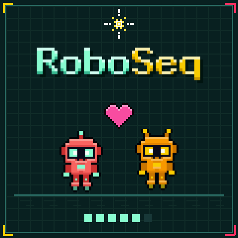 | **Switch on.** The robots walk in and meet under a heart while the dots fill. Any key skips it. Then HOME. |
| 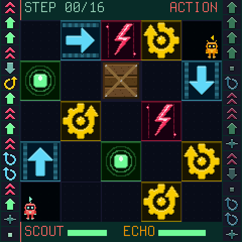 | **HOME is the board.** The tiles, Scout-7 (red, always on the left of its tile) and Echo-3 (orange, on the right), each with a wedge over its head saying where it faces. Down the left edge Scout-7's program, down the right Echo-3's, a step a row. Over the board the step and what the white keys change; under it the robots' health. |
| 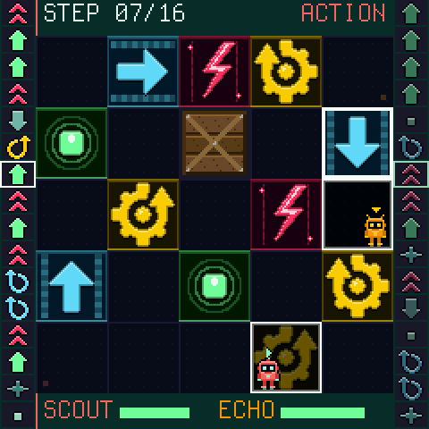 | **PLAY.** The robots move a step at a time. The tiles they set off light up, each program frames the step it plays, and a robot that runs too hot burns out and comes back in a far corner. PLAY again stops. |
| 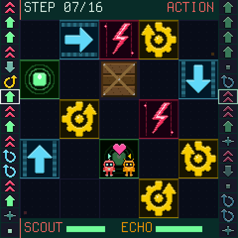 | **When they meet.** Two on one tile simply stand side by side. Linger together and a heart appears and a coin chimes; dash into the other and a star flashes over the one hit. |
| 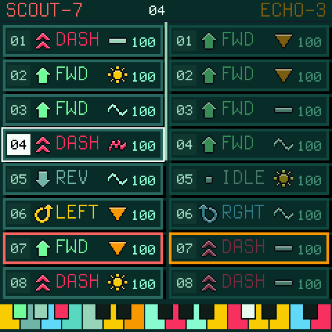 | **SEQ: the programs**, as step cards: number, move, modifier, chance; the card playing is framed in its robot's colour. SELECT moves the cursor (white), EDIT picks the robot. Type a program in with **W A S D** at the bottom of the keyboard (move, turn left, back, turn right) and the keys round them (idle, dash, ping): each move lands at the cursor and the cursor goes on, so you drive the program in. The coloured keyboard at the foot says what each key does. |
| 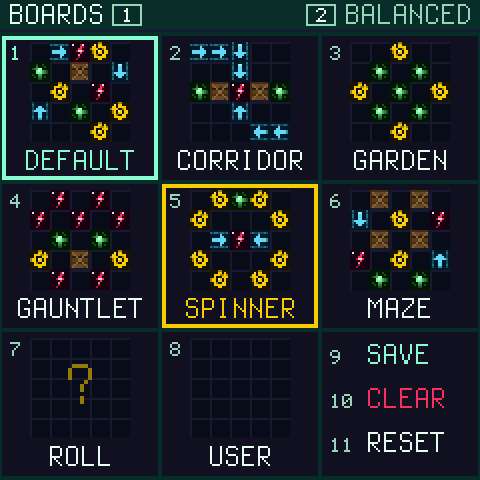 | **ENV: the boards**, all at a glance: the six presets, a random roll and your own board, each small with its white key. Press a key and that board comes in (while playing, as the loop comes round: framed yellow, blinking, until it arrives); the one playing is framed in mint. 9 saves the board as yours, 10 clears yours, 11 puts the robots back on their pads. The black keys steer as on HOME. |
| 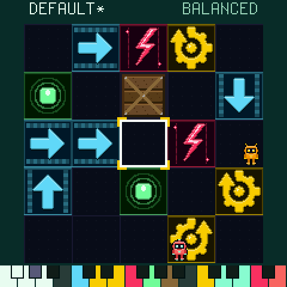 | **ENV again: build a board.** W A S D move the cursor; further up a key for each tile (belt, rotator left and right, zap, pulse, crate), and the black key between S and D clears. A belt points the way you last moved; press it again to turn it. The robots meet your tiles on their next step. KNOB1 runs through the six preset boards. |
| 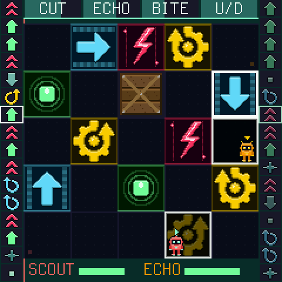 | **REC: play solo.** The keys become a SID-style lead over the robots, the knobs its CUT, ECHO, BITE and OCT, shown as faders across the top. **ARP** arpeggiates a chord you hold, a note each step: K4 its pattern, SELECT how fast. REC again gives the keys back. |
| 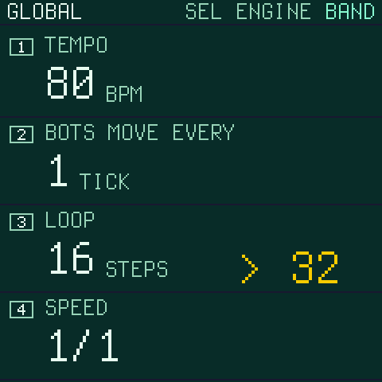 | **GLO: tempo and time.** The tempo, how often the robots move (every 1, 2 or 4 ticks), the loop's length (it changes as the loop comes round, never stopping the music) and the speed (1/1, 1/2, 1/4). SELECT picks the engine: BAND or ORIGINAL (below). |
| 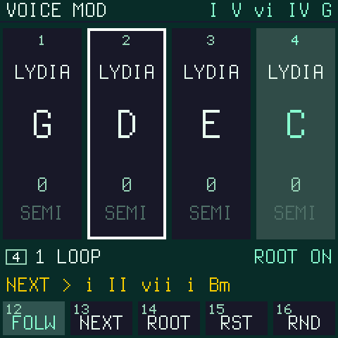 | **SCL: Voice Mod**, the harmony: four steps of scale, root and semitone that the music moves through, every so many loops or by hand (NEXT). White keys 1-4 pick a step, K1-K3 change it. |
| 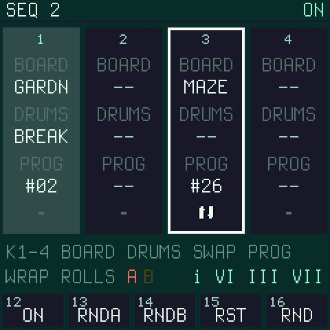 | **SCL again: Seq 2**, the arrangement: four steps that change the board and the drum pattern and can swap the robots' registers, as Voice Mod comes round. |
| 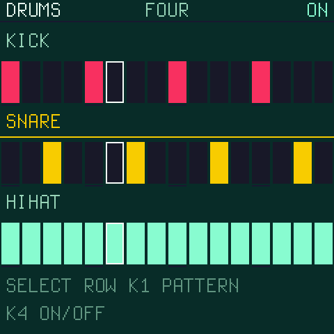 | **LFO: the drums.** Kick, snare and hihat over 16 steps; SELECT picks the row, a white key a step, KNOB1 the six patterns. |
| 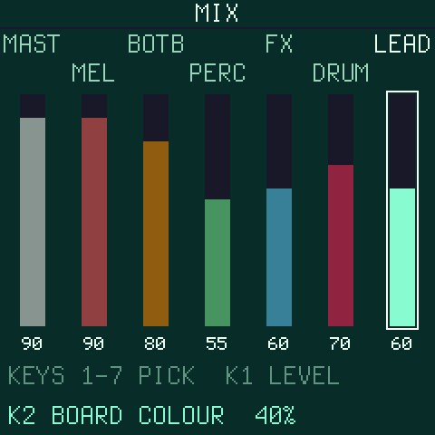 | **FX: the mix.** Master, the five buses and the lead as faders (white keys 1-7 pick, KNOB1 sets). KNOB2, BOARD COLOUR: how much the board's tiles colour the whole sound. |

## The panel

The FM-1's panel is printed, so its names are the firmware's names. What each control is:

| Control | What it is |
|---|---|
| **PLAY** | Start the board from its beginning; stop. It flashes the beat while playing. |
| **HOME, SEQ, SEL (SCL), LFO, FX, ENV, GLO** | The pages: the board, the programs, Voice Mod and (pressed again) Seq 2, the drums, the mix, the boards and (pressed again) the board builder, the global settings. The page's button is lit. |
| **EDIT** | Whose program the keys edit: Scout-7 or Echo-3 (lit: Echo-3). |
| **REC** | The keys and knobs play the lead (lit). Again: back. |
| **ARP** | The keys a chord, arpeggiated (lit; it brings the lead with it). |
| **SELECT** (encoder) | On HOME what a white key changes (a step's move, modifier or chance); on SEQ the cursor; on the drums the row; with ARP on, how fast the arp runs (1-4 notes a step). |
| **K1-K4** | The page's values; with REC on, the lead's CUT, ECHO, BITE and OCT (with ARP on, K4 the arp's pattern). They never stop the music. |
| **White keys** | Positions where a page has steps; on SEQ and ENV a game controller (W A S D and the keys above them). |
| **Black keys** | Steer the robots, on every page but the two builders, SEQ and ENV's second page (below). |
| **OCT- / OCT+** | The next 16 steps of a long program (HOME), the cursor 8 steps (SEQ), the lead's octave (REC). |
| **MASTER** (the knob) | The volume. |

The FM-1's keys have no lights, so the screen always shows what the keys do: the programs down the board's sides,
the faders across the top while the lead plays, a coloured keyboard at the foot of the builders.

## Playing it

RoboSeq is played by reaching into the robots while they run; what you change is heard on their next step.

**Steer them.** The black keys are two hands of five, F#3 to D#4 for Scout-7 and F#4 to D#5 for Echo-3: TURN LEFT,
MOVE, TURN RIGHT, DASH, PING. A key makes that robot's next move this one, once, then its program goes on. The last
black key, F#5, swaps the robots' registers (who plays high, who plays low).

**Change their programs as they play.** On HOME the 16 white keys are the picked robot's steps, its program down the
side of the board: a key turns the step to its next move (or, with SELECT, its modifier or its chance). On SEQ the
same programs are cards you type into with W A S D, the cursor moving on as you go, like driving the robot through
its moves; undo, roll a program, roll both, swap or clear them on the top keys.

**Change their world.** ENV shows every board: a white key drops one in (it arrives as the loop comes round). ENV
again builds the board under them, tile by tile, while they walk it; on both KNOB1 runs through the presets. Seq 2 can change the board and the drums
for you, a step each time Voice Mod comes round.

**Play over them.** REC turns the keyboard into a lead: a sharp SID voice (pulse and saw together, a wide sweeping
pulse width, folded where it is driven hard, an open filter, a ping-pong echo in time), the last key held winning
and gliding when you play legato. K1 CUT opens and closes its filter, K2 ECHO its echo, K3 BITE its edge, K4 OCT its
octave (the note you hold goes with it). ARP arpeggiates the chord you hold, a note each step: K4 picks up, down, up
and down, two octaves up or down, or random, and SELECT makes it faster, 1 to 4 notes a step. Only ARP arpeggiates.

### What the moves and tiles do

| Move | | Tile | |
|---|---|---|---|
| FWD / REV | a tile forward / back (walls and crates stop it) | Belt | carries a robot on, mid-step |
| LEFT / RGHT | a quarter turn | Rotator | turns a robot left or right |
| DASH | two tiles; into the other robot, it hits it | Zap rail | heats a robot (too hot and it burns out) |
| PING | a pulse straight ahead; the other robot in its line is zapped | Pulse pad | cools it |
| IDLE | stays, so the tiles can sing | Crate | blocks the way |

A step's **modifier** colours its note (steady, bright, low, wobble, glitch) and its **chance** (100, 75, 50 %) says
how likely it is to fire on a loop. How hot a robot runs, where it stands and which way it faces shape the notes it
plays; Voice Mod's scale and root keep them in key.

## The sound

RoboSeq has one game and two engines, picked with SELECT on GLO. **BAND**, where it starts, is RoboSeq's own: the
robots as a band. **ORIGINAL** is the browser original's score, note for note. What every move, tile and setting does
in each is in [docs/roboseq/ENGINES.md](docs/roboseq/ENGINES.md); in short:

**BAND.** The board is the robots' keyboard: a cell is a note of the key, a step on the board a step in the scale,
a dash a third.
- **The tunes.** The robots go back to their pads every loop and walk the same way again, so their tunes come back
  every bar. The rhythm is their moves: a note where a robot gets to a new cell, held while it turns or leans on a
  wall, a wait a rest, and the chord on the beats.
- **Call and answer.** Scout-7 sings the tune. In the first half of each phrase it sings three beats and Echo-3
  answers in the fourth with Scout-7's own motif; in the second half they sing together. Half way through a phrase
  the tune lands on the chord's fifth, at its end on the root.
- **The tiles shape the notes.** A zap rail's note is short and hard, a pulse pad's long, with vibrato. A belt
  plays an arpeggio its way, a rotator bends the note in, and bumping a crate stops it dead. WOBBLE sings with a wide
  vibrato, and long notes get a slow one.
- **The bass.** Each board has its own groove: DEFAULT three-three-two, CORRIDOR straight eighths, GARDEN a walk,
  GAUNTLET a gallop, SPINNER octaves, MAZE syncopation, and a rolled or your own board one by its tiles. Echo-3 plays
  into it, and at each phrase's end the bass runs into the next chord.
- **The synths.** The tiles on each robot's side of the board touch its synth a little.
- **The big one.** Every other phrase ends in it, as dense as the original: an arpeggio of the chord over the tune,
  shaped by the original's own arp rules (the chord from where Scout-7 stands, the contour from its facing, the span
  from its heat, the rate from its tile).
- **Heat.** It counts as in the original: zap rails, and the other robot's dash or ping, make a robot hotter and
  louder, so steering them into each other turns the music up.
- **The drummer.** It plays your pattern with dynamics, ghost notes, fills and crashes.
- **The chords.** Voice Mod's random writes one of 73 named progressions in one of six keys. FOLLOW (SCL key 12)
  writes a new one, following on, every round, and Seq 2 can chain them.

**ORIGINAL** is the browser original's music, note for note: the same game and the same score, checked against the
HTML's own script tick by tick over 36 scenarios (88,120 notes). The voices, the mix, the reverb and the limiter are
measured against renders of the HTML's own audio in a browser (most voices within 0.15 dB in level, shape and
timbre), and the mix is in stereo as the HTML's is. Two things are as the original meant rather than as it happened
to play: its FX bus and reverb are heard (a routing loop silenced them in the browser), and a voice started twice at
one moment no longer cuts the step short. The rest is new for the FM-1: the SID lead and its echo, the half speed,
and BOARD COLOUR, which lets a board's tiles colour the whole sound a little (an open board a bigger room, zap rails
brighter and drier, pulse pads warmer and wetter; at 0 % it is the original's sound).
[DECISIONS.md](docs/roboseq/DECISIONS.md) has each reason.

## Build

```sh
make test       # the model against the HTML, the sound against its renders, the app on this computer
make fw         # build/roboseq.fwsc (JieLi toolchain and AC79 SDK: docs/DINGHY_README.md)
make emu        # the package in fm1-emu, headless and strict: the model, the audio load, build/emu/panel.png
make check      # the package and Dinghy's platform tests, as CI runs them
make screens    # this README's screens, drawn by the firmware (docs/screens)
make song       # the default song played on the computer: build/host/song.wav
make lead       # a solo with the lead over it: build/host/lead.wav
```

On macOS `make test` and the host builds run in a small Docker image (`make image`), because Dinghy's host mode needs
Linux's sections. `make reference` re-renders the browser original's sound (node and a Chromium).

## Where things are

- [docs/roboseq/CONTROLS.md](docs/roboseq/CONTROLS.md): every control, page by page, and the rules they keep
- [docs/roboseq/ENGINES.md](docs/roboseq/ENGINES.md): the two engines, BAND and ORIGINAL: what every move, tile and setting does in each
- [docs/roboseq/DECISIONS.md](docs/roboseq/DECISIONS.md): why things are as they are
- [ROADMAP.md](ROADMAP.md): the phases and the playability rules
- [PLATFORM.md](PLATFORM.md): the Dinghy commit and what differs from it
- [reference/](reference/): the browser original and its SHA-256
- `tools/tone-ref/`, `tools/trace/`: how the sound and the score are checked against the original; `tools/art/`: the
  pixel art, as code

## Licence

GPL-3.0-only, as Dinghy; [LICENSING.md](LICENSING.md) says who made what.
